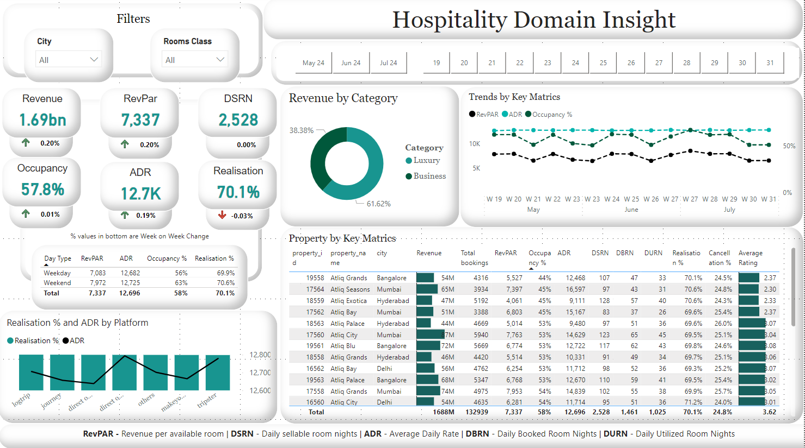
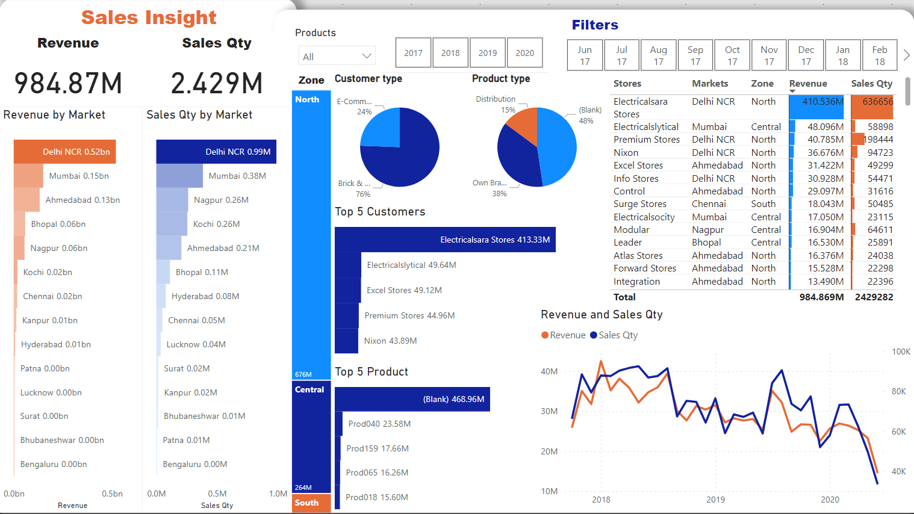
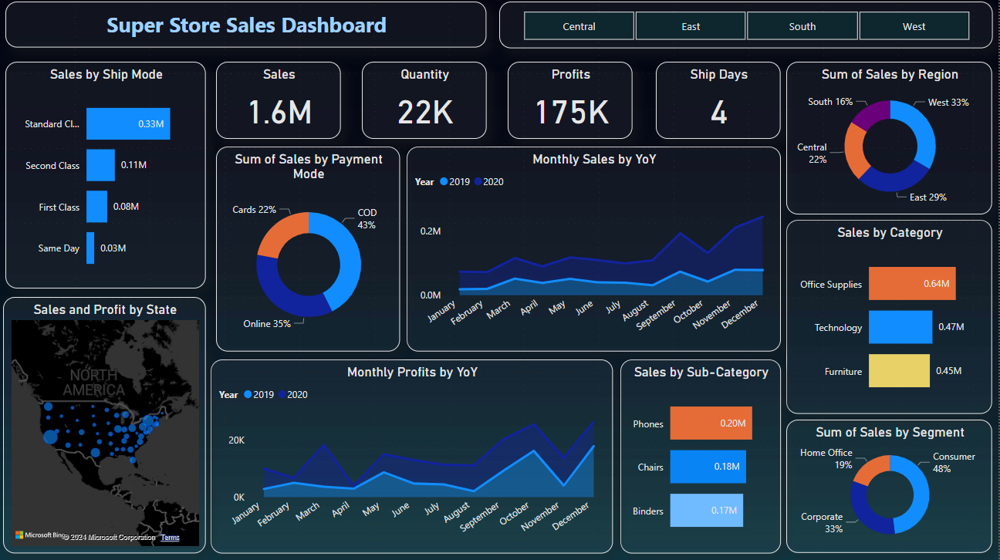
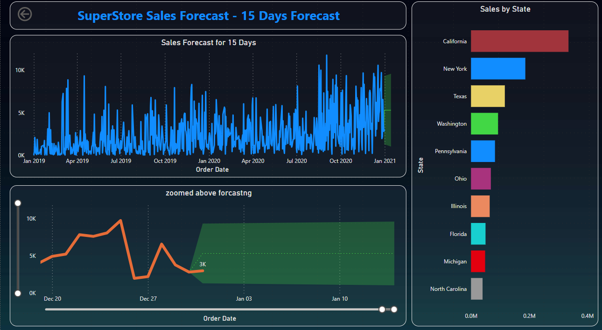
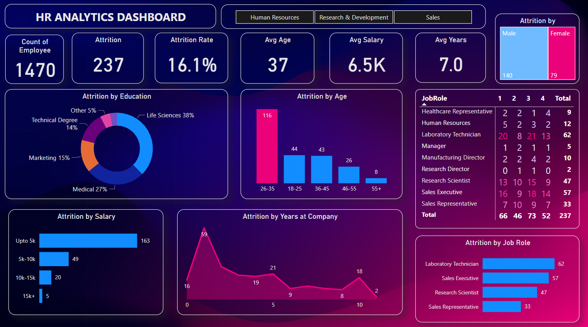
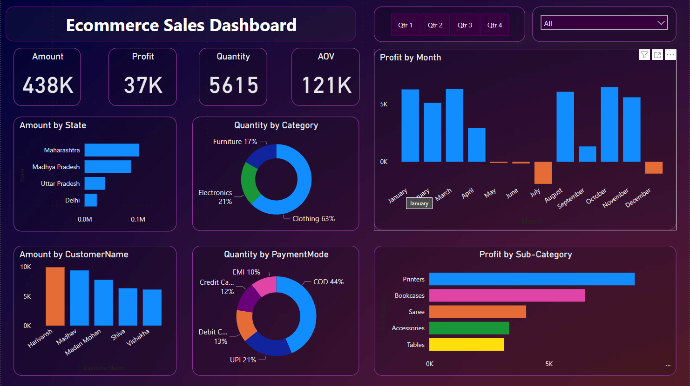

# Power BI Dashboards

  
  
  

Five business dashboards, each built to move from a headline KPI to the questions behind it. Every `.pbix` file is in this repo; open it in Power BI Desktop to explore the model, measures and slicers.

| Dashboard | Domain | Highlights |
|---|---|---|
| [AtliQ Hospitality Insights](#atliq-hospitality-insights) | Hotels | Revenue, occupancy, ADR, RevPAR, DSRN, weekly trends |
| [AtliQ Sales Insights](#atliq-sales-insights) | Hardware sales | MySQL source, Power Query cleaning, currency normalization |
| [Superstore Sales & Forecasting](#superstore-sales--forecasting) | Retail | Sales performance and forecasting |
| [HR Analytics](#hr-analytics) | People | Attrition by role, department and demographics |
| [E-commerce Performance](#e-commerce-performance) | Online retail | Sales, profit, quantity, payment-mode and geography mix |

---

## AtliQ Hospitality Insights

Revenue insights for **AtliQ Grands**, a fictional chain of 5-star hotels in India facing new competition (a [Codebasics](https://codebasics.io) case study).

- **Model:** hotel, room, booking, aggregated-booking and date tables, joined into one star-style model with slicers by city, room class and week
- **Metrics:** revenue, occupancy %, **ADR**, **RevPAR**, **DSRN**, realisation % and cancellation rate, with week-over-week change
- **Insight:** the dashboard supports dynamic-pricing decisions by showing where weekday and weekend demand and platform mix diverge

## AtliQ Sales Insights

A sales-performance dashboard for **AtliQ Hardware**, whose sales director needed key metrics and trends in one interactive view.

- **Source:** a MySQL database with five tables (customers, products, markets, date, transactions)
- **Preparation in Power Query:** filtered out zero and negative sales and irrelevant markets, normalized USD transactions to INR, and built table relationships
- **Views:** revenue and quantity by year, quarter, region and market; top and bottom products and customers; revenue trend

## Superstore Sales & Forecasting

## HR Analytics

## E-commerce Performance

Sales, profit, quantity and average order value by state, category, customer and payment mode, with quarterly slicers. [View in Power BI →](https://app.powerbi.com/links/glHq7djgzp?ctid=34bd8bed-2ac1-41ae-9f08-4e0a3f11706c&pbi_source=linkShare)

---

Built by <b>Mehul Gupta</b> · more dashboards on <a href="https://public.tableau.com/app/profile/mehul.gupta7649/vizzes">Tableau Public</a> · <a href="https://mgupta646.github.io/">Portfolio</a>
